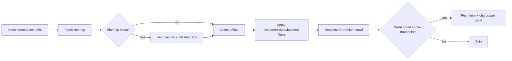

# Sitemap to AI Corpus: Crawl Any Site for RAG & LLM Training

[](https://apify.com/Turboextract/sitemap-to-ai-corpus)
[](LICENSE)
[](#pricing)

**Feed in a sitemap.xml URL. Get back every page as clean, structured JSON for AI training, RAG pipelines, and content intelligence.** Built for ML engineers and AI teams who don't want to hand-compile URL lists.

Paste one sitemap. Get one dataset. Pay only for pages with real content.

**Try it now →** [apify.com/Turboextract/sitemap-to-ai-corpus](https://apify.com/Turboextract/sitemap-to-ai-corpus)

> This repository holds documentation and ready-to-run API examples. The actor itself runs on the Apify platform - no installation needed.

---

## Why this exists

- **Hand-built URL lists don't scale.** Every site already publishes the full list of its pages in `sitemap.xml` — this actor reads it for you, including nested sitemap indexes.
- **Generic crawlers waste money on junk.** Following navigation links pulls in tag pages, pagination and login screens. A sitemap is the site's own list of real content.
- **Thin pages pollute training data.** Pages under your `minWordCount` are skipped and never billed.
- **Refreshing a corpus should be incremental.** `lastmodAfter` re-crawls only pages that changed since your last run.

---

## Who this is for

- **AI / ML engineers** building training corpora from blogs, documentation sites, and editorial archives
- **RAG developers** populating vector stores with every page on a target domain
- **Dataset curators** harvesting an entire site's published content in a single run
- **Content intelligence teams** monitoring the full output of competitors or partner sites
- **Researchers** assembling source corpora across many domains

If you currently maintain a hand-rolled sitemap parser plus a content scraper, this replaces both.

---

## What you get per page

```json
{
  "url": "https://example.com/blog/rag-explained",
  "title": "How Retrieval Augmented Generation Works",
  "description": "A practical guide to RAG architectures.",
  "author": "Jane Doe",
  "publishedAt": "2026-04-12T08:30:00Z",
  "language": "en",
  "wordCount": 1842,
  "text": "Retrieval augmented generation combines a retriever with a generator...",
  "scrapedAt": "2026-05-02T14:02:11Z"
}
```

The output JSON shape matches **AI Training Dataset Builder** — chain the two actors freely.

Real output from a verified run: [examples/sample-output.json](examples/sample-output.json).

---

## How it works



Sitemap indexes (sitemap-of-sitemaps) are followed recursively up to 5 levels. Filters apply before crawling so you don't pay for pages you'd discard.

---

## Quick start

### From the Apify Console (no code)

1. Click **Try for free**.
2. Paste your sitemap.xml URL.
3. (Optional) Add an include or exclude regex.
4. Click **Start**.
5. Download the dataset as JSON, CSV, or Excel — or stream it into your pipeline.

### From the API ([curl](examples/curl.sh))

```bash
curl -X POST "https://api.apify.com/v2/acts/Turboextract~sitemap-to-ai-corpus/runs?token=YOUR_TOKEN" \
  -H "Content-Type: application/json" \
  -d '{
    "sitemapUrls": [
      { "url": "https://blog.apify.com/sitemap.xml" }
    ],
    "urlPatternInclude": "/blog/",
    "lastmodAfter": "2025-01-01",
    "maxPages": 500,
    "minWordCount": 200
  }'
```

### From Python ([full example](examples/python.py))

```python
from apify_client import ApifyClient

client = ApifyClient("YOUR_TOKEN")
run = client.actor("Turboextract/sitemap-to-ai-corpus").call(run_input={
    "sitemapUrls": [{"url": "https://blog.apify.com/sitemap.xml"}],
    "maxPages": 200,
})
for item in client.dataset(run["defaultDatasetId"]).iterate_items():
    print(item["title"], item["wordCount"])
```

### From Node.js ([full example](examples/node.mjs))

```javascript
import { ApifyClient } from 'apify-client';

const client = new ApifyClient({ token: 'YOUR_TOKEN' });
const run = await client.actor('Turboextract/sitemap-to-ai-corpus').call({
    sitemapUrls: [{ url: 'https://blog.apify.com/sitemap.xml' }],
    maxPages: 200,
    minWordCount: 200,
});
const { items } = await client.dataset(run.defaultDatasetId).listItems();
console.log(items);
```

---

## Input fields

| Field | Type | Default | Description |
|---|---|---|---|
| `sitemapUrls` | array | required | One or more sitemap.xml URLs (indexes auto-followed) |
| `urlPatternInclude` | string | — | Regex; only matching URLs are crawled |
| `urlPatternExclude` | string | — | Regex; matching URLs are skipped |
| `lastmodAfter` | string | — | ISO date; skip entries with older lastmod |
| `maxPages` | integer | 500 | Safety cap per run |
| `minWordCount` | integer | 50 | Skip thin pages |
| `includeImages` | boolean | false | Attach image URLs from article body |
| `useApifyProxy` | boolean | true | Route through Apify Proxy |

---

## Pricing

**Pay per page processed. No subscriptions.**

| Volume | Price per page | Total |
|---|---|---|
| First 50 pages (free tier) | $0.000 | $0.00 |
| Per page after that | $0.005 | 1,000 pages = $5 |
| 10,000 pages | $0.005 | $50 |

You only pay for pages that return clean content above your word-count threshold. Sitemap fetching, filtered-out URLs, and thin pages cost nothing.

### How it compares

| Tool | Pricing model | 1,000 pages |
|---|---|---|
| **Sitemap to AI Corpus** | $0.005 per page | **$5** |
| Apify Web Content Crawler | Per result + compute | $7 to $15 |
| Diffbot Article API | $299 per month base | $300+ |
| Custom in-house crawler | Engineer time | $500+ build cost |

---

## Common use cases

- **LLM fine-tuning datasets** from a target site's full archive
- **RAG knowledge bases** populated from `/docs/` or `/blog/` sections
- **Competitive content audits** comparing publishing cadence and depth
- **Site migrations** exporting every page's content as structured JSON
- **Research corpora** assembling sources across many domains

---

## Tips for best results

- Start with `maxPages: 20` to verify extraction quality on your target site
- Use `urlPatternInclude` like `/blog/` or `/docs/` to scope to one section
- Set `minWordCount` higher (200 to 500) for long-form-only datasets
- Use `lastmodAfter` to do incremental refreshes — pair with a weekly scheduler

---

## Pairs well with

- **[AI Training Dataset Builder](https://apify.com/Turboextract/ai-training-dataset-builder)** — same JSON shape; use this actor to discover URLs at scale, then pin specific URL lists in the Builder for surgical updates
- **Reddit Brand Monitor & Lead Finder** — combine site-wide content with social signals
- **Website Lead Extractor** — pair full-site crawl with B2B contact extraction

---

## FAQ

**What if a site doesn't have a sitemap?**
Most modern sites do — check `/sitemap.xml`, `/sitemap_index.xml`, or `robots.txt` for the location. If there's no sitemap, use **AI Training Dataset Builder** with a manual URL list instead.

**Does it handle JavaScript-rendered pages?**
Yes. The actor uses headless Chromium via Playwright, so SPAs and JS-heavy sites work the same as static HTML.

**How deep does sitemap recursion go?**
Up to 5 levels of nested sitemap indexes. Most sites don't nest beyond 2.

**Can I crawl multiple sitemaps in one run?**
Yes — pass several URLs in `sitemapUrls`. URLs are deduplicated across sitemaps.

**What about robots.txt?**
The actor reads sitemaps you specify directly. If a site disallows crawling, respect that — the actor doesn't bypass robots.txt directives, but it also doesn't read them. You're responsible for compliance with each site's terms.

**Can I run this on a schedule?**
Yes. Apify's built-in scheduler runs the actor on any cron expression. Combine with `lastmodAfter` for incremental refreshes.

**What if a page fails?**
Failed pages are logged and skipped. You are not charged for failures.

---

## SEO keywords

For visitors who arrived here from search: this tool is also referred to as a **sitemap crawler**, a **sitemap.xml scraper**, a **website to JSON converter**, a **full-site content extractor for RAG**, a **LLM training corpus from a website**, a **sitemap to dataset tool**, a **website knowledge base builder**, and a **bulk web page text extractor**.

---

## Support

- Open an issue on this repo for bug reports - please include your run input
- Actor page on Apify: [apify.com/Turboextract/sitemap-to-ai-corpus](https://apify.com/Turboextract/sitemap-to-ai-corpus)
- Community Discord: [discord.gg/8SrXSCpvgj](https://discord.gg/8SrXSCpvgj) - updates, support and feature requests
- Maintained by [Turboextract](https://apify.com/Turboextract) on the Apify platform

## License

[MIT](LICENSE) - examples and documentation. The actor itself is hosted on Apify under their platform terms.
